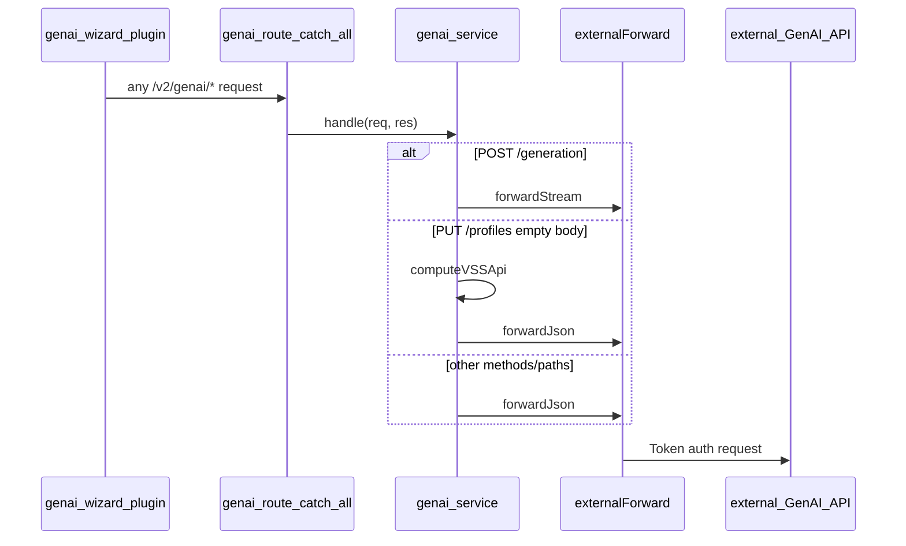

# GenAI service (plugin proxy)

The backend exposes GenAI endpoints under `/v2/genai/*` for the genai-wizard plugin and related integrations. These routes authenticate the caller with the normal backend JWT middleware, then call the external GenAI API directly using configurable credentials.

This replaces the former **genai-proxy** sidecar. Prototype/Dashboard/Widget code generation (SDV Copilot, user assets, marketplace add-ons) goes through `POST /v2/genai/generate` (see [Code generation](#code-generation-post-v2genaigenerate)).

## Authorization

The whole `/v2/genai/*` router requires a valid JWT (`401` anonymous) **and** the `generativeAI` permission (`PERMISSIONS.GENERATIVE_AI`, `403` without it). The check is applied right after `auth()`, so it covers `GET /token`, `POST /generate` and the upstream catch-all.

## Code generation (`POST /v2/genai/generate`)

Resolves the upstream server-side, so it works even when `EXTERNAL_GENAI_URL` is not configured. The client never sends an URL, method or key.

Body (unknown keys are rejected with `400`):

| Field | Rule |
|---|---|
| `source` | `sdv-copilot` \| `asset` \| `marketplace`, required |
| `assetId` | ObjectId; required when `source=asset`, forbidden otherwise |
| `addonId` | string (max 200); required when `source=marketplace`, forbidden otherwise |
| `type` | `GenAI_Python` \| `GenAI_Dashboard` \| `GenAI_Widget`, required |
| `prompt` | trimmed string, 1–20000 chars, required |
| `systemMessage` | string (may be empty, max 20000 chars), optional |
| `modelId` | ObjectId, optional (CVI grounding) |

Response: `200 { "content": "<generated code>" }`.

Sources:

| Source | Upstream |
|---|---|
| `sdv-copilot` | Site config `GENAI_SDV_APP_ENDPOINT` (`503` if empty). `POST { systemMessage, message: prompt }`; content is `content`, `data` or the JSON body |
| `asset` | The caller's `GENAI-PYTHON` asset (`404` missing, `403` without `READ_ASSET` on it, `400` wrong type). `url`, `accessToken`, `method`, `requestField`, `responseField` are read from `asset.data` |
| `marketplace` | `GENAI_MARKETPLACE_URL` (default `https://store-be.digitalauto.tech`, `404` if empty) `/package?type=…&exposeCredentials=true`, entry matched by `version._id === addonId` and `type` (`404` otherwise) |

For `asset`/`marketplace`, `GET` calls `<url>?<requestField>=<prompt>`; `POST` sends `{ systemMessage, [requestField]: prompt }`, with `Authorization: <key>`. The answer is read from `responseField` (`502 Upstream returned an unexpected response format` if missing).

**CVI grounding:** when `modelId` is given, the caller must be able to read the model (`modelService.getModelById`: `404` missing, `403` for a private model without `READ_MODEL`); then `apiService.computeVSSApi(modelId)` is flattened to leaf signal paths (capped at ~2000 entries / ~60k chars) and appended to the system message as `Vehicle API (VSS) available in this model:`.

**Outbound hardening:** 60 s timeout, 5 MB response cap, no redirects; failures map to `502 GenAI upstream request failed` without leaking the upstream URL or key; logs use `redactUrl`. Every outbound URL (all three sources, including the marketplace listing) passes [`assertSafeOutboundUrl`](../src/utils/assertSafeOutboundUrl.js): only `http`/`https`, host resolved with `dns.promises.lookup({ all: true })`, and the request is rejected with `400 Generator endpoint is not allowed` if any address is loopback (`127.0.0.0/8`, `::1`), link-local (`169.254.0.0/16`, `fe80::/10`), unspecified (`0.0.0.0`, `::`) or an IPv4-mapped form of those. RFC1918 private ranges are allowed.

## Architecture

Backend modules for GenAI traffic:

| Module | Role |
|---|---|
| [`src/services/externalForward.service.js`](../src/services/externalForward.service.js) | Generic authenticated HTTP forwarder (JSON + SSE streaming, base URL map, error mapping) |
| [`src/services/genai.service.js`](../src/services/genai.service.js) | Thin GenAI adapter: path/environment parsing, profile VSS fallback, delegates to the forwarder |
| [`src/services/serviceToken.service.js`](../src/services/serviceToken.service.js) | Issues short-lived service keys (issuers can be added to the map) |

[`src/routes/v2/system/genai.route.js`](../src/routes/v2/system/genai.route.js) authenticates all callers, serves `GET /token` locally, then uses a catch-all for upstream GenAI forwarding.



## Environment variables

| Variable | Required | Description |
|---|---|---|
| `EXTERNAL_GENAI_URL` | Yes (for GenAI features) | Upstream GenAI base URL |
| `EXTERNAL_GENAI_DEVICE_TOKEN` | Yes (for GenAI features) | Upstream device token (`Authorization: Token …`) |
| `GENAI_URL` | No (deprecated) | Legacy sidecar proxy target; used only when `EXTERNAL_GENAI_*` is unset |

When neither built-in external config nor `GENAI_URL` is set, forwarded GenAI routes return `503` with `{ message: 'GenAI service is not implemented' }`. `GET /v2/genai/token` does not require GenAI upstream config. Issuer credentials are injected by the platform environment and are not operator-configured.

## Service tokens

`GET /v2/genai/token?service=azure-speech` (JWT required) mints a short-lived key for a configured third-party service. Long-lived secrets come from the platform environment; the backend returns only what the client needs to call that service.

This path is handled **before** the GenAI catch-all and is never forwarded to the external GenAI API.

| Query | Description |
|---|---|
| `service` | Issuer id. Currently `azure-speech`. |

| Condition | Status |
|---|---|
| Missing or unknown `service` | 400 |
| Issuer credentials not provided by the platform | 503 |
| Azure STS mint fails | 502 |
| Success | 200 |

Example success:

```json
{
  "service": "azure-speech",
  "token": "<sts-token>",
  "region": "eastus"
}
```

The long-lived subscription key never leaves the server. Clients must use Speech SDK `fromAuthorizationToken` with the returned STS token.

Add another issuer by registering a function on the `ISSUERS` map in `serviceToken.service.js` and including the id in `SUPPORTED_SERVICES`.

## Path handling

The GenAI adapter strips optional `/dev`, `/prod`, or `/staging` path segments and always forwards to `EXTERNAL_GENAI_URL`:

| Incoming path | Upstream path |
|---|---|
| `/generation` | `/generation` |
| `/generation/dev` | `/generation` |
| `/profiles/model-1` | `/profiles/model-1` |
| `/profiles/model-1/prod` | `/profiles/model-1` |
| `/conversations/{id}/history` | same |
| `/actuator/info` | same |

## Upstream URL construction

`upstreamPath` is derived from the client request path and is appended to a **fixed** operator host. That is the same contract as a reverse proxy with a hard-coded upstream: the client cannot change the host.

1. [`resolveGenAIPath`](../src/services/genai.service.js) strips the query string first, then handles three shapes: `/generation[/env]`, `/profiles[/id[/env]]`, and a literal passthrough for everything else (for example `/actuator/info`, `/conversations/…`).
2. The base URL is `EXTERNAL_GENAI_URL`, loaded at process startup. The client cannot influence it.
3. The combined URL is always `<fixed-operator-host><sanitized-or-passthrough-path>`. The worst a caller can do is request an arbitrary path on the already-trusted GenAI service, which is intended.

Host SSRF is not possible because the host is not client-controlled.

## Profile upsert without body

If `PUT /v2/genai/profiles/{modelId}` is called without a VSS payload, the backend computes the model API locally via `apiService.computeVSSApi(modelId)` and transforms it to the GenAI profile format. This replaces the old sidecar hardcoded call to `playground-be`.

## Migration from genai-proxy sidecar

1. Set on the main backend container:

```env
EXTERNAL_GENAI_URL=http://genai:8080
EXTERNAL_GENAI_DEVICE_TOKEN=your-device-token
```

2. Remove the sidecar configuration:

```env
# Remove
GENAI_URL=http://genai-proxy:8080
```

3. Remove the `genai-proxy` service from Docker Compose.

4. Restart the backend and verify:
   - `POST /v2/genai/generation` streams SSE events
   - `GET /v2/genai/actuator/info` returns upstream version
   - Plugin profile ensure (`PUT /v2/genai/profiles/{modelId}`) succeeds

## Debugging

Enable development logging (`NODE_ENV=development`) to see `[genai]` debug lines for upstream requests, stream lifecycle, and profile upsert fallbacks.
